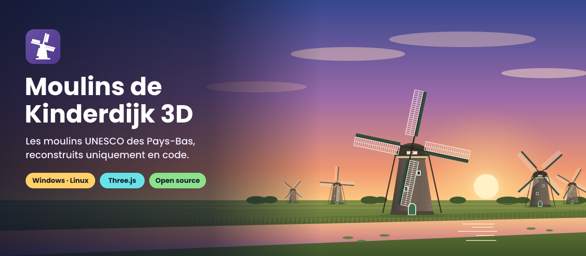
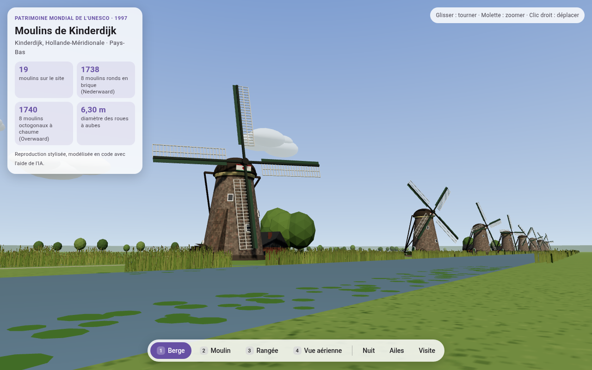
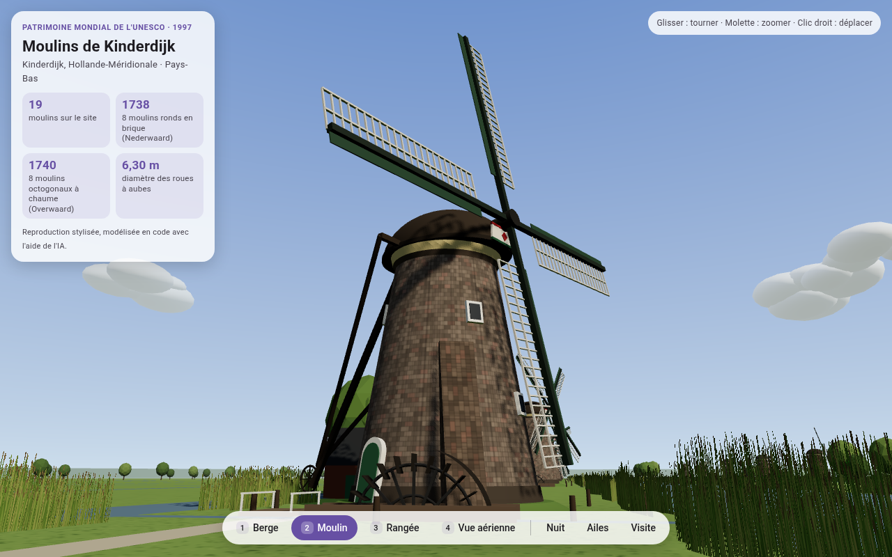
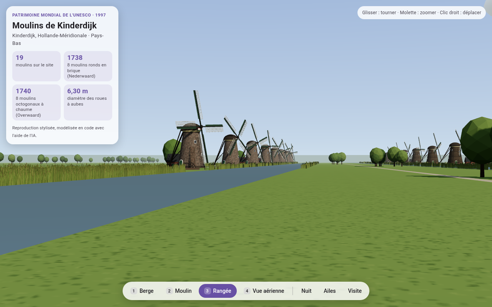
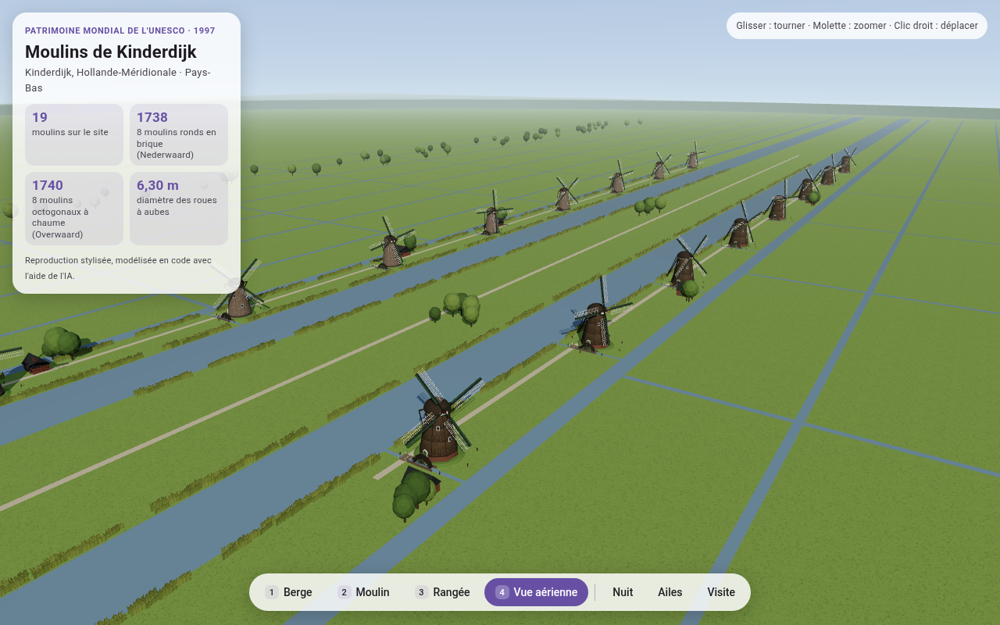
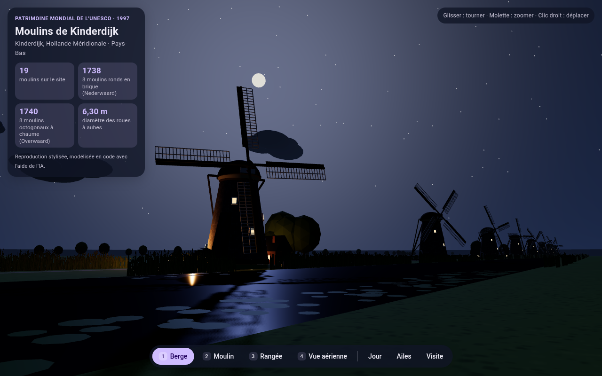

<p align="center">
  
</p>

<p align="center">
  <a href="https://github.com/JulesROGUE/moulins-kinderdijk-3d/releases/latest"></a>
  
  
  
</p>

<p align="center"><b>Les moulins de Kinderdijk (Pays-Bas), reconstruits en 3D uniquement avec du code.</b></p>

<p align="center">
  <a href="https://github.com/JulesROGUE/moulins-kinderdijk-3d/releases/latest"><b>⬇️ Télécharger (Windows / Linux)</b></a>
</p>

---

## L'idée

Le défi : reproduire le site des moulins de Kinderdijk, inscrit au patrimoine mondial de l'UNESCO en 1997, **sans aucun modèle 3D ni texture téléchargés**. Tout est généré en code avec Three.js : les fûts en brique, les moulins octogonaux en chaume, les ailes en treillis, la roue à aubes, les roseaux, l'eau des boezems et le ciel.

Le modèle a été réalisé avec l'aide de l'IA et calé sur des photos réelles (Wikimedia Commons) : proportions du fût, de la calotte et des ailes mesurées sur les images, nombre et forme des éléments répétés, couleurs des matériaux, contexte au sol. Les chiffres historiques viennent de sources publiques (voir plus bas). Le résultat est une **reproduction stylisée**.

Le tout est livré comme une petite application de bureau Electron, compilée pour Windows et Linux par GitHub Actions.

## Aperçu

<p>
  
  
</p>
<p>
  
  
</p>
<p>
  
</p>

## Références visuelles

Ces photos ont servi uniquement à mesurer et à comparer. **Elles ne sont pas redistribuées** : ni dans l'application, ni dans ce dépôt.

| Image (Wikimedia Commons) | Ce qu'on en a tiré |
|---|---|
| [Kinderdijk windmill.jpg](https://commons.wikimedia.org/wiki/File:Kinderdijk_windmill.jpg) | Rapports du moulin rond : hauteur du fût ≈ 1,33 × diamètre à la base, haut ≈ 0,6 × base, rayon des ailes ≈ 1,3 × base ; fenêtres à cadre blanc, porte verte cintrée, « baard » blanc et rouge, ailes qui descendent près du sol |
| [Kinderdijk - Molen Nederwaard 3.jpg](https://commons.wikimedia.org/wiki/File:Kinderdijk_-_Molen_Nederwaard_3.jpg) | Silhouette de face, calotte sombre sur une couronne claire, jambes de force de la queue, berge et roseaux |
| [Kinderdijk - Molen Overwaard No. 3.jpg](https://commons.wikimedia.org/wiki/File:Kinderdijk_-_Molen_Overwaard_No._3.jpg) | Moulin octogonal : fût à huit pans couvert de chaume, socle en brique, petites fenêtres |
| [Nederwaard molens no 1 tm 5 (2021)](https://commons.wikimedia.org/wiki/File:Kinderdijk,_Nederwaard_molens_no_1tm5_RM30543tm7_IMG_9354_2021-06-13_11.04.jpg) | Rangée vue depuis l'autre rive, murs de roseaux, nénuphars : cadrage du point de vue « Berge » |
| [Overview windmills Kinderdijk.jpg](https://commons.wikimedia.org/wiki/File:Overview_windmills_Kinderdijk.jpg) | Alignement et espacement régulier des moulins : point de vue « Rangée » |
| [Kinderdijk Windmills Panorama.jpg](https://commons.wikimedia.org/wiki/File:Kinderdijk_Windmills_Panorama.jpg) | Largeur du boezem, berges basses, polder plat |
| [Vue depuis la calotte du moulin n° 7 (RCE)](https://commons.wikimedia.org/wiki/File:Overzicht_met_molen_No._6_van_de_Nederwaard_op_de_voorgrond,_gezien_vanuit_de_kap_van_molen_No.7_van_de_Nederwaard_-_Kinderdijk_-_20370474_-_RCE.jpg) | Vue plongeante : moulin sur une digue étroite entre deux plans d'eau, chemin, forme de la calotte et de la queue |

## Ce qui est modélisé

| Élément | Construction | Dimensions retenues |
|---|---|---|
| 8 moulins ronds en brique (Nederwaard, 1738) | `CylinderGeometry` ouvert + `CanvasTexture` de brique, socle sombre, corniche, fenêtres et porte | Ø 10,4 m à la base, Ø 6,2 m en haut, fût de 13,6 m |
| 8 moulins octogonaux en chaume (Overwaard, 1740) | `CylinderGeometry` à 8 pans + texture de roseau, arêtes en bois, socle en brique | Ø 11,2 m aux angles, socle de 1,6 m + fût de 12 m |
| Calotte (kap) | demi-sphère étirée, couronne claire, « baard » décoré, tête d'arbre inclinée de 10° | 3 m de haut, axe des ailes à environ 16 m du sol |
| Ailes | 2 vergues croisées, planches au bord d'attaque, treillis de 23 barreaux par aile, fusionnés (`mergeGeometries`) puis instanciés | envergure d'environ 28 m (estimée sur les photos), treillis de 2,1 m de large |
| Queue, jambes de force, treuil, poteaux | poutres orientées entre deux points (`BoxGeometry`), `TorusGeometry` | pied de queue à environ 11 m de l'axe du moulin |
| Roue à aubes | anneau, 8 rayons et 24 aubes sous un capot en demi-cylindre, murets du bief, passerelle à garde-corps blancs | **Ø 6,30 m** (source) |
| Contrefort du moulin n° 1 | `ExtrudeGeometry` d'un trapèze en brique | ajouté vers 1870 (source), 8 m de haut |
| Polder | eau fusionnée (boezems, fossés, biefs, la Lek), panneaux de roseaux en `alphaTest`, nénuphars, arbres instanciés, maisons de garde, digue (`ExtrudeGeometry`) | boezems de 26 à 28 m de large, environ 100 m entre deux moulins (estimation) |
| Ciel | `ShaderMaterial` en dégradé, soleil, lune, étoiles (`Points`), nuages instanciés, brouillard exponentiel | — |

Les 16 moulins complets tiennent en une poignée d'`InstancedMesh` (une trentaine de draw calls pour toute la scène). Le rendu se fait **à la demande** : pas de boucle permanente, une image au chargement, à chaque mouvement de caméra et pendant les animations lancées par un bouton.

## Commandes

| Action | Souris / clavier / bouton |
|---|---|
| Tourner autour | glisser avec le clic gauche |
| Zoomer | molette |
| Se déplacer | glisser avec le clic droit |
| Points de vue | boutons **Berge**, **Moulin**, **Rangée**, **Vue aérienne** ou touches **1** à **4** (aussi `#berge`, `#moulin`, `#rangee`, `#aerien`) |
| Jour / nuit | bouton **Nuit / Jour** ou touche **N** |
| Faire tourner les ailes | bouton **Ailes** |
| Visite guidée autour du premier moulin | bouton **Visite** (s'arrête dès qu'on reprend la main) |

## Installation

Téléchargez la dernière version sur la page [Releases](https://github.com/JulesROGUE/moulins-kinderdijk-3d/releases/latest).

**Windows** : téléchargez l'exécutable portable `Moulins.de.Kinderdijk.3D-1.0.0-portable.exe` et lancez-le, sans installation. L'exécutable n'est pas signé : si Windows SmartScreen affiche un avertissement, cliquez sur « Informations complémentaires » puis « Exécuter quand même ».

**Linux** :

```bash
# AppImage
chmod +x Moulins.de.Kinderdijk.3D-1.0.0-linux-x86_64.AppImage
./Moulins.de.Kinderdijk.3D-1.0.0-linux-x86_64.AppImage

# ou paquet .deb (Debian, Ubuntu…)
sudo apt install ./Moulins.de.Kinderdijk.3D-1.0.0-linux-amd64.deb
```

## Développement

```bash
npm install
npm start        # lance l'application en mode développement
npm run dist     # construit les paquets avec electron-builder
```

| Brique | Rôle |
|---|---|
| [Three.js](https://threejs.org/) 0.187.0 | rendu WebGL, géométries, OrbitControls, BufferGeometryUtils |
| Electron 45 | application de bureau |
| React 19 + Vite | surcouche (fiche, barre de commandes) et build |
| electron-builder + GitHub Actions | exécutable portable Windows, AppImage et .deb |

Organisation du code :

```
src/
  App.jsx            monte la scène et la surcouche
  viewpoints.js      points de vue nommés
  scene/             renderer, lumières, ciel, sol et eau, World (rendu à la demande)
  model/             dimensions (avec sources), moulin rond, moulin octogonal,
                     calotte, ailes, roue à aubes, maisons, textures générées
  ui/                fiche et barre de commandes
```

## Sources

- [Kinderdijk windmills, Wikipédia (en)](https://en.wikipedia.org/wiki/Kinderdijk_windmills) : 19 moulins, construits en 1738 (Nederwaard, en brique) et 1740 (Overwaard, octogonaux), inscription UNESCO en 1997
- [Kinderdijk, Wikipédia (nl)](https://nl.wikipedia.org/wiki/Kinderdijk) : « stenen grondzeilers » ronds de la Nederwaard, « rietgedekte achtkanters » de l'Overwaard
- [Nederwaard Molen No.1, Wikipédia (en)](https://en.wikipedia.org/wiki/Nederwaard_Molen_No.1) : roue à aubes en fer de 6,30 m, contrefort ajouté vers 1870
- [Nederwaard Molen No.2, Wikipédia (en)](https://en.wikipedia.org/wiki/Nederwaard_Molen_No.2) : roue à aubes de 6,30 m
- [Rijksmonumentenregister, monument 30546](https://monumentenregister.cultureelerfgoed.nl/monumenten/pdf/30546) : « ronde stenen boezemmolen, 1738 » (Nederwaard n° 4)
- [UNESCO, Mill Network at Kinderdijk-Elshout](https://whc.unesco.org/en/list/818)

## Licence

Code sous licence **MIT** © Jules ROGUE. Police Roboto sous licence SIL Open Font License (OFL).

Il s'agit d'une reproduction stylisée et non officielle, réalisée avec l'aide de l'IA, sans lien avec le site de Kinderdijk ni avec son gestionnaire.
